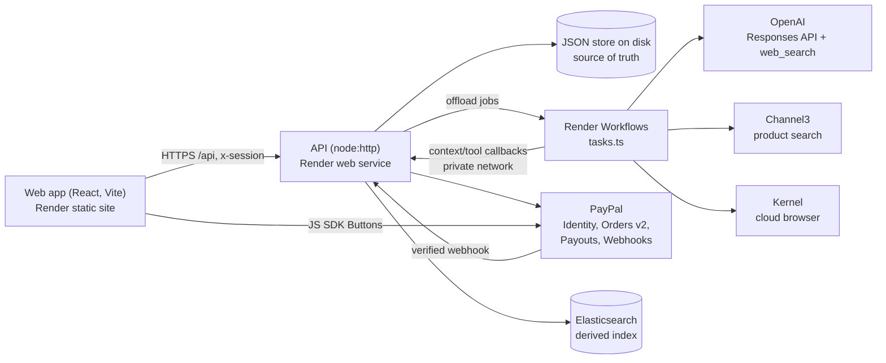
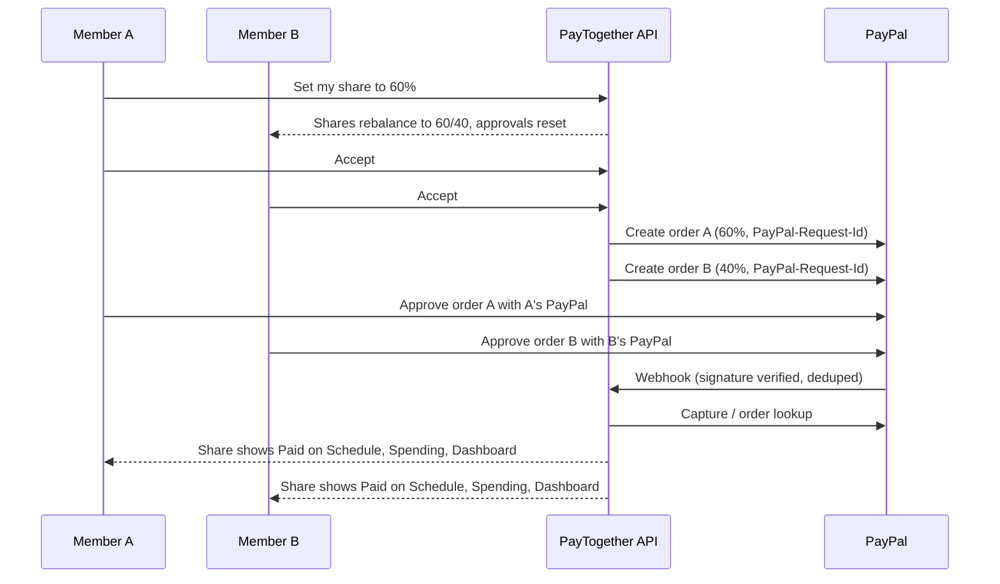

<p align="center">
  
</p>

<h1 align="center">PayTogether</h1>

<p align="center">
  <b>Plan a group trip with an AI host in the chat, then let every traveler pay their own share from their own PayPal account.<br>Nobody fronts the money, so nobody ends up chasing "I owe you"s.</b>
</p>

<p align="center">
  <a href="LICENSE"></a>
  
  
  
</p>

<p align="center">
  🎥 <b>Demo video:</b> coming soon · 🌐 <b>Live demo:</b> <a href="https://paytogether-web.onrender.com/">paytogether-web.onrender.com</a> · 📝 <b>Devpost:</b> TODO
</p>

<p align="center"><a href="#for-judges-try-it-in-2-minutes"><b>→ Judges: try it in 2 minutes</b></a></p>

---

## 💡 Inspiration: the problem

Where you want to go. What you need to buy. Who's coming. Every group trip starts with excitement in the group chat, and then reality sets in.

**Planning is a part-time job.** Expedia Group's *Path to Purchase* study found that travelers spend **303 minutes (over 5 hours)** with travel content and view **141 pages** in the 45 days before booking a trip. U.S. travelers view as many as **277**. That's for *one* person. Add a group of friends with different opinions, and the work falls on whoever volunteers to "figure it out."

**Money is where friendships crack.** In Experian's June 2025 survey of people who travel with friends, **unexpected costs** and **splitting costs fairly** were the two biggest financial stress points across every generation. More than **half of Gen Z and millennial travelers** have had a money disagreement with friends on a trip, **1 in 5** has ended a friendship over money, and only **1 in 4** friend groups sets a budget upfront.

**Whoever fronts the money pays the price.** Zelle's *Avoidance Economy* report found that **76%** of Gen Z who covered a group expense were never fully repaid, and **47%** went into debt because of it. **1 in 5** has canceled plans or muted the group chat just to avoid a conversation about paying someone back. The chat where the trip was born becomes the place people hide.

**So people pay a "peace tax."** A 2026 CIT Bank survey conducted by The Harris Poll found that **82%** of group travelers are willing to pay more than their fair share to avoid a money argument, rising to **90%** among Gen Z. And **72%** of Gen Z group travelers have already had money problems on a trip.

**These travelers are already on PayPal.** According to SimilarWeb traffic data, **25–34** is PayPal's largest age group (**27.6%**), and **18–24** adds another **19.0%**. That puts **nearly half** of PayPal's audience under 35, the same generation that struggles most with group-trip money.

So we asked: *what if the trip planned itself in the chat where it already starts, and no one ever had to front the money?*

That's **PayTogether**.

PayTogether was built during the PayPal AI Hackathon submission period (Oct 1 – Nov 12, 2026); the first commit is from Nov 7, 2026.

---

## 🚀 Innovation

PayTogether splits the bill **before** checkout. Each member pays **their own share, from their own PayPal account**, straight to the merchant (or to the store's PayPal). No one fronts the money, so there's no IOU to chase. An AI host, **Wayfinder**, does the planning in the group chat so the organizer doesn't have to.

---

What is new compared with split-the-bill apps:

- **Split before checkout, not after.** Every bill becomes one PayPal order per member, so there is no debt to record or chase.
- **Consent before charge.** No order exists until everyone on the bill accepts the split; any change resets the approvals.
- **An AI host that is structurally unable to move money.** Wayfinder plans, searches, polls and prices, but has no payment tool.
- **Pay a store now, split it later.** One member pays a vendor's PayPal (or a phone number through PayPal Payouts), and the bill becomes the group's split.

### What's next

- Pay Later and Venmo as payment options for a share
- Kernel-assisted checkout in the web UI (the backend is ready)
- Mobile app on the live backend
- Private budgets and smarter uneven splits (e.g. by room or by night)
- More occasions beyond trips: shared houses, events, gifts

---

## 🧭 User experience

- **Log in with PayPal.** Your PayPal identity is your account, and the same identity pays your share.
- **Trips for one or for a group.** Friends join with a 6-character code or an invite to their PayPal email. Home shows what you've spent, what's pending and which bills wait for your approval, across all your trips.
- **Wayfinder, the AI trip host** walks the group through the phases **Destinations → Timeline → Places → Pricing → Booked → On trip → Settled**. It proposes destinations, drafts a night-by-night timeline, finds real stays with web search and Channel3 product search, runs polls, and prices the winners. It can edit the plan when asked ("one more night in Porto"), and the trip length stays the same.
- **Split bills, paid separately.** Every bill starts as an equal split. A member sets their own share and the rest rebalance in proportion, so shares always total 100%. Everyone on the bill accepts, then each one pays their own PayPal order. If a member takes 100%, only that member has to accept.
- **Pay at a store, split later.** One member pays a vendor now (to the vendor's PayPal email, or to a phone number via PayPal Payouts); the bill then becomes the group's split.
- **Log expenses** as *Already paid* (the others owe the logger, settled via PayPal) or *Just planned* (each pays their share later).
- **See the money:** Bryntum schedule (stops row + one row per member), AG Grid split bills, payments due and transactions, AG Charts dashboard, and Elasticsearch search over transactions ("hotel > 100").

---

The flow from a new account:

1. **Log in with PayPal** → an empty home dashboard (spent, pending, bills to accept).
2. **New trip** → *Just me* or *With a group*; friends join with a 6-character code or an invite to their PayPal email.
3. **Plan** tab: chat with Wayfinder, confirm Destinations → Timeline → Places (everyone confirms each phase, stays are picked by poll).
4. **Spending** tab: split bills open automatically for the winning stays; each member adjusts only their own share, accepts, and pays.
5. **Schedule** and **Dashboard**: every payment moves **Awaiting payment → Verifying → Paid**, with each member's color *and* symbol.

---

## 🤖 Use of AI

**Wayfinder** is an agent built on the **OpenAI Responses API** ([`Backend/src/wayfinder.ts`](Backend/src/wayfinder.ts)); its behavior rules are in [`CLAUDE.md`](CLAUDE.md) (Wayfinder rules) and its system prompt in `wayfinder.ts`.

| Model | Role |
|---|---|
| `gpt-5.5` (reasoning effort medium) | Wayfinder chat turns and tool calls |
| `gpt-5-mini` | "Should Wayfinder reply?" classifier, so it doesn't answer every chat message (an `@wayfinder` mention always gets a reply) |

- **Hand-written tool loop** (up to 20 steps per turn). Every tool argument is validated with **Zod** before it runs; invalid arguments go back to the model as an error instead of being coerced.
- **Phase-gated tools.** The model only sees the tools allowed in the current phase:
  - Any phase: `get_trip_state`, `search_products` (Channel3)
  - Before Pricing: `update_trip`, `set_stops`, `set_nights` (plan edits that keep the trip length)
  - Planning: `propose_destinations`, `draft_timeline`, `validate_timeline`, `create_poll`, `enrich_option`, `build_price_preview`
  - Later: `get_schedule`, `query_transactions`, `get_balances`, `suggest_settlement`
  - Destinations and Places: OpenAI's built-in **`web_search`** for real stays and restaurants with real prices
- **Automatic pricing.** Entering Pricing prices every stop's winning stay and opens split bills.
- **Runs on Render Workflows** when configured: Wayfinder turns, the reply check and product search run as workflow tasks ([`Backend/src/tasks.ts`](Backend/src/tasks.ts)) and call back to the API over Render's private network.

### What the AI can't do

- **Wayfinder can't move money.** It has no tool that creates, captures, refunds or transfers a payment, and none that edits a member's split. It only proposes; members confirm and pay in PayPal.
- `suggest_settlement` only suggests who-pays-whom; members pay each other themselves.
- Search results and product data go to the model as **untrusted tool data**, never into the system prompt.
- After Places is confirmed, app events (splits, payments) no longer trigger Wayfinder turns; it still answers members who write in the chat.

### Claude is for coding, not in the product

The app's AI is **OpenAI only**. We used **Claude Code** as our coding assistant while building PayTogether; [`CLAUDE.md`](CLAUDE.md) and `.claude/skills/` are its project guide and skills. No Claude model runs in the app, and there is no Anthropic SDK in the code.

---

## 🛠️ Technical execution

### Architecture



The web app polls the trip every 2 seconds. The API owns all trip state and every rule (quorum confirms, poll ties, split math, payment status) in [`Backend/src/store.ts`](Backend/src/store.ts). Elasticsearch is a derived index; the JSON store is the source of truth. Without `RENDER_API_KEY` the API runs the workflow jobs itself, so local development needs only one process.

### The split math

All money is **integer cents**; shares are **basis points that sum to 10,000** ([`FrontEnd/shared/trip.ts`](FrontEnd/shared/trip.ts)).

- **Largest remainder:** each share gets `floor(total × bp / 10000)` cents, and the leftover cents go to the largest fractional remainders, so the shares always add up to the total exactly. Example: $187.45 ÷ 4 → $46.87 + $46.86 + $46.86 + $46.86.
- **Rebalancing:** when a member sets their own share, `rebalanceShares` spreads the rest over the others in proportion to their current shares, so the total stays 100%.
- **Settlement:** `balances` (paid minus owed) and `settle` (fewest who-pays-whom transfers).
- Tested with `node --test` in [`FrontEnd/shared/trip.test.ts`](FrontEnd/shared/trip.test.ts) and [`Backend/src/store.test.ts`](Backend/src/store.test.ts).

### Security & trust

- **Webhook-verified payment status:** every PayPal webhook is signature-verified and deduplicated by event id; the browser never marks a payment paid.
- **Idempotency:** `PayPal-Request-Id` on order create and capture.
- **Consent before charge:** orders are created only after everyone on the bill accepts; any split change resets approvals. Deleting a bill needs everyone's vote and is refused once a share is approved or paid.
- **Members edit only their own share.**
- **Signed sessions:** HMAC-signed `x-session` from Log in with PayPal; `ACCESS_TOKEN` gates the hosted API; CORS limited to `WEB_ORIGIN`; workflow callbacks need `ACCESS_TOKEN`.
- **Trip-scoped search:** every Elasticsearch query is filtered by the trip id.
- **The AI can't move money,** and external content reaches it only as untrusted tool data.
- **No secrets in the client:** PayPal, OpenAI and sponsor keys stay on the server.

### Testing

```bash
cd Backend && npm test              # store rules, sessions, Wayfinder tools (node --test)
cd Backend && npm run typecheck
cd FrontEnd && node --test shared/  # split math, timeline, search, settlement
cd FrontEnd/web && npm run lint && npm run build
```

Single backend test: `cd Backend && npm test -- --test-name-pattern "<name>"`. Payments are tested by hand in the PayPal sandbox (approve → capture → webhook → Paid).

### Project structure

```
CLAUDE.md             agent guide: architecture, invariants, Wayfinder rules
Backend/              API (see Backend/README.md)
Backend/src/
  server.ts           node:http API routes (/api), Zod validation, PayPal webhook
  store.ts            trip state and every rule-bearing mutation, JSON persistence
  wayfinder.ts        OpenAI Responses API agent and its phase-gated tools
  integrations.ts     PayPal, Log in with PayPal + sessions, Channel3, Kernel, Elasticsearch
  workflows.ts        offload jobs to Render Workflows (or run them in-process)
  tasks.ts            Render Workflows task definitions
FrontEnd/             clients (see FrontEnd/README.md)
FrontEnd/shared/      trip model, integer-cents split math, settlement (no imports)
FrontEnd/web/         Vite + React web app (Plan, Spending, Schedule, Dashboard)
FrontEnd/mobile/      Expo + React Native prototype (sample data)
render.yaml           Render Blueprint (api, web, workflows)
```

### Getting started (local setup)

#### Prerequisites

- **Node.js 24** (the backend runs `.ts` files directly with Node's type stripping; Render uses `NODE_VERSION=24`)
- A **PayPal Developer** account (free) for sandbox credentials
- An **OpenAI API key** (Wayfinder)
- Optional: Channel3, Kernel, Elastic and Render keys. Each integration is off with a clear HTTP 503 until its keys are set.

No database or Docker is needed: trips are stored in `Backend/data.json`.

#### 1. Clone and install

```bash
git clone https://github.com/hoangviet2/PayTogether.git
cd PayTogether
cd Backend && npm install && cd ..
cd FrontEnd/web && npm install && cd ../..
```

#### 2. Configure the backend

```bash
cp Backend/.env.example Backend/.env
```

| Variable | Required? | What it is / where to get it |
|---|---|---|
| `OPENAI_API_KEY` | Yes (for Wayfinder) | platform.openai.com → API keys |
| `PAYPAL_ENV` | Yes | `sandbox` |
| `PAYPAL_CLIENT_ID`, `PAYPAL_CLIENT_SECRET` | Yes | developer.paypal.com → Apps & Credentials → Sandbox → your app |
| `PAYPAL_WEBHOOK_ID` | For webhooks | The webhook's id from the same app page (see below) |
| `SESSION_SECRET` | Recommended | Any long random string; signs login sessions (unset: sessions end on restart) |
| `CHANNEL3_API_KEY` | Optional | Channel3 dashboard; turns on product search |
| `KERNEL_API_KEY` | Optional | Kernel dashboard; turns on cloud-browser checkout |
| `ELASTIC_URL`, `ELASTIC_API_KEY` | Optional | Elastic Cloud deployment; without them search runs in-process |
| `RENDER_API_KEY`, `RENDER_WORKFLOW_SLUG` | Optional | Render → Account Settings → API Keys; leave empty locally |
| `ACCESS_TOKEN` | Hosted only | Gates the API on a public host; leave empty locally |
| `WEB_ORIGIN` | Hosted only | The web site's URL, for CORS |
| `PORT`, `DATA_FILE` | Optional | Default `8787` and `Backend/data.json` |

Web app (optional, `FrontEnd/web/.env.local`): `VITE_AG_GRID_LICENSE` and `VITE_BRYNTUM_LICENSE` remove the trial watermark/badge. Both libraries run without a license in trial mode. `VITE_API_URL` is only for a deployed build; in dev Vite proxies `/api` to `http://localhost:8787`.

#### 3. PayPal sandbox setup

1. developer.paypal.com → **Apps & Credentials → Sandbox → Create App**. Copy the client id and secret into `Backend/.env`.
2. In the app's **Features**, turn on **Log in with PayPal**: add `http://localhost:5173` (no trailing slash) as a Return URL, tick **Full name** and **Email**, and set Privacy policy and User agreement URLs (`https://example.com` is fine in sandbox).
3. **Sandbox → Accounts:** create two or more **Personal** (buyer) accounts to log in and pay as different members.
4. **Webhooks (optional locally):** expose the API with a tunnel (e.g. `ngrok http 8787`), add a webhook at `https://<tunnel>/api/paypal/webhook` subscribed to `CHECKOUT.ORDER.APPROVED`, `PAYMENT.CAPTURE.COMPLETED`, `PAYMENT.CAPTURE.DENIED`, `PAYMENT.CAPTURE.DECLINED`, and copy its id to `PAYPAL_WEBHOOK_ID`. Without a tunnel, payments still show as Paid through the server's own capture/order lookup; approvals and failures need the webhook.

#### 4. Run

```bash
# terminal 1
cd Backend && npm run dev          # API on http://localhost:8787

# terminal 2
cd FrontEnd/web && npm run dev     # web app on http://localhost:5173 (fixed port: it is PayPal's Return URL)
```

Open **http://localhost:5173** and click **Log in with PayPal**.

#### Deploy to Render

[`render.yaml`](render.yaml) is a Render Blueprint: **New → Blueprint** on this repo creates `paytogether-api`, `paytogether-web` and `paytogether-workflows`. Set `VITE_API_URL` on the web service to the API's URL, `WEB_ORIGIN` on the API to the web service's URL, add the API keys, and add the web URL as a Return URL in the PayPal app.

---

## 🤝 Sponsor integrations

Each sponsor tool has a real job in the app. Every integration is off with a clear HTTP 503 naming the missing variable until its keys are set.

### Channel3 (`@channel3/sdk`)

**Online product search that supports the web search engine.** Wayfinder's `search_products` tool searches Channel3's product catalog (gear, tickets, anything the group needs) alongside OpenAI's `web_search`, and poll options record their source (`web_search` or `channel3`). The **Shop** section on Spending searches Channel3 directly (query + max price, in the trip currency) and turns a product into a split bill.

**Where:** `searchProducts` in [`Backend/src/integrations.ts`](Backend/src/integrations.ts), `productTool` in [`Backend/src/wayfinder.ts`](Backend/src/wayfinder.ts), `GET /api/products`, [`FrontEnd/web/src/Shop.tsx`](FrontEnd/web/src/Shop.tsx), `search-products` task in [`Backend/src/tasks.ts`](Backend/src/tasks.ts)

### Render

Hosting via a Blueprint ([`render.yaml`](render.yaml)) with three services: `paytogether-api` (Node web service + persistent disk), `paytogether-web` (static site), and `paytogether-workflows` (**Render Workflows**, `@renderinc/sdk`) that runs every AI/agent job (`wayfinder-turn`, `should-reply`, `search-products`, `open-checkout`, `close-checkout`) plus `paypal-orders` and `index-txns`, falling back to in-process if a run fails

**Where:** [`render.yaml`](render.yaml), [`Backend/src/workflows.ts`](Backend/src/workflows.ts), [`Backend/src/tasks.ts`](Backend/src/tasks.ts)

### AG Grid (Enterprise 36)

Split bills / Payments due grid with a Pay button per row, and the transactions grid with member-colored rows

**Where:** [`FrontEnd/web/src/Bills.tsx`](FrontEnd/web/src/Bills.tsx), [`FrontEnd/web/src/Spending.tsx`](FrontEnd/web/src/Spending.tsx)

### AG Charts (14)

Spending dashboard: donut of spend per member, stacked bars per stop and member, bars per spending type

**Where:** [`FrontEnd/web/src/Dashboard.tsx`](FrontEnd/web/src/Dashboard.tsx)

### Bryntum Scheduler (8, Enterprise)

Schedule tab: a stops row plus one row per member; payments show with their PayPal stage; double-click your row to log an expense

**Where:** [`FrontEnd/web/src/Schedule.tsx`](FrontEnd/web/src/Schedule.tsx), [`FrontEnd/web/src/bryntum.css`](FrontEnd/web/src/bryntum.css)

### Elastic / Elasticsearch (`@elastic/elasticsearch`)

Indexes each trip's transactions and serves Spending search ("hotel > 100"), always filtered by trip id; rows are removed when a trip or bill is deleted. Falls back to in-process search without keys.

**Where:** `indexTxn`, `searchTxnIds`, `deleteTripDocs` in [`Backend/src/integrations.ts`](Backend/src/integrations.ts)

### Kernel (`@onkernel/sdk`)

Cloud browser sessions for assisted checkout (`POST /api/checkout`, `open-checkout`/`close-checkout` workflow tasks). Wired in the backend; the current web UI does not call it.

**Where:** `openCheckout`, `closeCheckout` in [`Backend/src/integrations.ts`](Backend/src/integrations.ts)

### Other tools

| Tool | What we use it for | Where in the code |
|---|---|---|
| **OpenAI** (`openai`) | Wayfinder (Responses API, `gpt-5.5`, `gpt-5-mini`, built-in `web_search`) | [`Backend/src/wayfinder.ts`](Backend/src/wayfinder.ts) |
| Zod | Validates every API body and every AI tool argument | [`Backend/src/server.ts`](Backend/src/server.ts), [`Backend/src/wayfinder.ts`](Backend/src/wayfinder.ts) |
| React 19 + Vite + TypeScript | Web app | [`FrontEnd/web/`](FrontEnd/web/) |
| KaTeX | Renders math in chat | [`FrontEnd/web/src/ui.tsx`](FrontEnd/web/src/ui.tsx) |
| Node.js `node:http` | API server (no framework), JSON file store | [`Backend/src/server.ts`](Backend/src/server.ts), [`Backend/src/store.ts`](Backend/src/store.ts) |
| Expo + React Native | Mobile prototype on sample data | [`FrontEnd/mobile/`](FrontEnd/mobile/) |
| oxlint, `node --test` | Lint and tests |  |

---

## 🅿️ PayPal services we use

PayPal is the backbone: identity, every payment, and the only source of truth for payment status.

| PayPal product / API | What we use it for | Where in the code |
|---|---|---|
| **Log in with PayPal** (Identity, OAuth 2.0 authorization code → `/v1/identity/oauth2/userinfo`) | Sign-in. The PayPal user id becomes the member's identity; the server issues an HMAC-signed `x-session`. A trip seat belongs to a PayPal user. | [`Backend/src/integrations.ts`](Backend/src/integrations.ts) (`loginUrl`, `paypalUser`, `newSession`), `POST /api/auth/paypal` in [`Backend/src/server.ts`](Backend/src/server.ts) |
| **Orders v2** (`/v2/checkout/orders`, capture, order lookup) | **One order per member share.** A $400 hotel split four ways is four separate orders, each approved from a different PayPal account. Expired orders are replaced before paying; approved ones are captured server-side. | `createOrder`, `captureOrder`, `orderStatus` in [`Backend/src/integrations.ts`](Backend/src/integrations.ts); `POST /api/trips/{id}/previews/{pid}/pay` in [`Backend/src/server.ts`](Backend/src/server.ts) |
| **Orders v2 `payee.email_address`** | In-store bills pay **the store's PayPal account directly**, not ours. | `createOrder({ payee })`; `POST /api/trips/{id}/store-bills`, `POST /api/trips/{id}/store-pay` |
| **Payouts** (`/v1/payments/payouts`, `recipient_type: PHONE`) | "Paid at a store" with a phone number: the payment is captured to PayTogether, then paid out to that phone. | `sendPayout` in [`Backend/src/integrations.ts`](Backend/src/integrations.ts) |
| **Webhooks** + `/v1/notifications/verify-webhook-signature` | Every event's signature is verified and deduplicated by event id. `CHECKOUT.ORDER.APPROVED`, `PAYMENT.CAPTURE.COMPLETED`, `PAYMENT.CAPTURE.DENIED`, `PAYMENT.CAPTURE.DECLINED` drive payment status. | `verifyWebhook`; `POST /api/paypal/webhook` and `applyStatus` in [`Backend/src/server.ts`](Backend/src/server.ts) |
| **`PayPal-Request-Id`** | Idempotency on order create and capture, so a retry never makes a second order or charge. | `pp()` in [`Backend/src/integrations.ts`](Backend/src/integrations.ts) |
| **PayPal JavaScript SDK** (Buttons) | The Pay button for each share. Each SDK URL (ours, or a store's `merchant-id`) loads under its own `data-namespace`. | `loadSdk` in [`FrontEnd/web/src/ui.tsx`](FrontEnd/web/src/ui.tsx) |
| **PayPal Sandbox** | Everything runs against `api-m.sandbox.paypal.com` (`PAYPAL_ENV=sandbox`). | [`Backend/src/integrations.ts`](Backend/src/integrations.ts) |

### Why this kills "I owe you"



- **Separate accounts, separate orders.** Each share is its own PayPal order paid by its own member. The bill is never paid by one person on behalf of the group, so there's no debt left over.
- **Agree first, charge second.** No order is created until everyone on the bill has accepted the split. Changing any share resets the approvals.
- **Status only from PayPal.** A payment is marked paid only by a verified webhook or our own server-side capture/order lookup, never by the browser.
- **When someone did front the money** (a logged *Already paid* expense), the others' shares become PayPal requests owed to that member, and Wayfinder can suggest the fewest transfers to settle up.

---

## Team

- **Anh (Vivian) Vo** · [@anhvo2211](https://github.com/anhvo2211)
- **Viet (Ben) Hoang** · [@hoangviet2](https://github.com/hoangviet2)

Licensed under the [GNU General Public License v3.0](LICENSE).

---

## For judges: try it in 2 minutes

1. Open the live demo: **[https://paytogether-web.onrender.com](https://paytogether-web.onrender.com/)**. It is free to use through Dec 15, 2026.
2. Click **Log in with PayPal** and sign in with a PayPal **sandbox** account:

   | Sandbox account | Email | Password |
   |---|---|---|
   | Traveler A | `sb-w9vwu53882014@personal.example.com` | `TestPayTogether` |
   | Traveler B | `sb-a5zb4753882035@personal.example.com` | `TestPayTogether` |

   Open a second browser (or a private window) for Traveler B, so you can see two people pay separately.
3. As Traveler A: **New trip → With a group**. Share the 6-character join code shown on the setup page. Traveler B enters it under **Join**. (Or pick **Just me** for a solo trip.)
4. On the **Plan** tab, tell Wayfinder where you want to go (e.g. *"Lisbon and Porto, May 14–23, about $1,500 each"*). Confirm the destinations, then the timeline, then vote in the stay polls Wayfinder builds from live search results.
5. Confirm Places. Wayfinder prices each winning stay and opens a **split bill**. On the **Spending** tab, each member can change their own share (the others rebalance so it always adds up to 100%), then accepts.
6. When everyone has accepted, each member gets their **own PayPal order** for their own share. Each one clicks **Pay** and approves it in the PayPal sandbox popup.
7. Watch the payment go **Awaiting payment → Verifying → Paid** on the **Schedule** (Bryntum) and the **Spending** grid and **Dashboard** (AG Grid / AG Charts).
8. Try **Shop** at the bottom of Spending: search products (Channel3), then turn one into an equal split bill. Or use **Paid at a store** to pay a vendor's PayPal directly and split it.

There is no seeded demo trip: every account starts with an empty home dashboard and creates its own trip.
